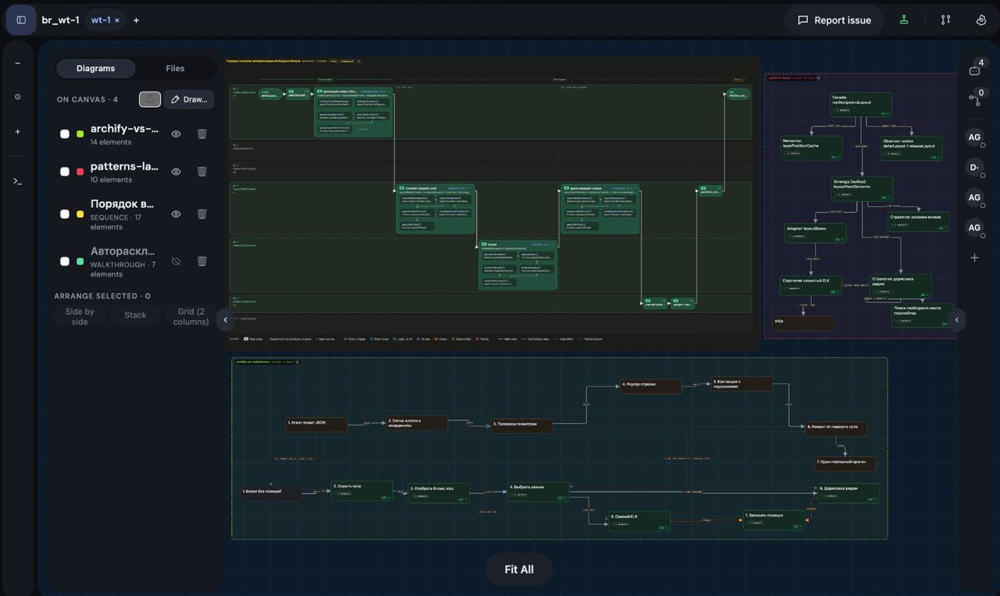
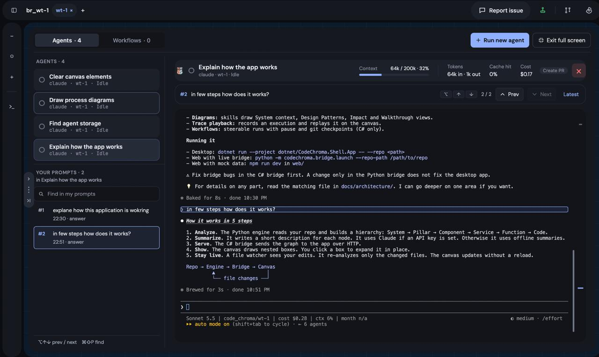
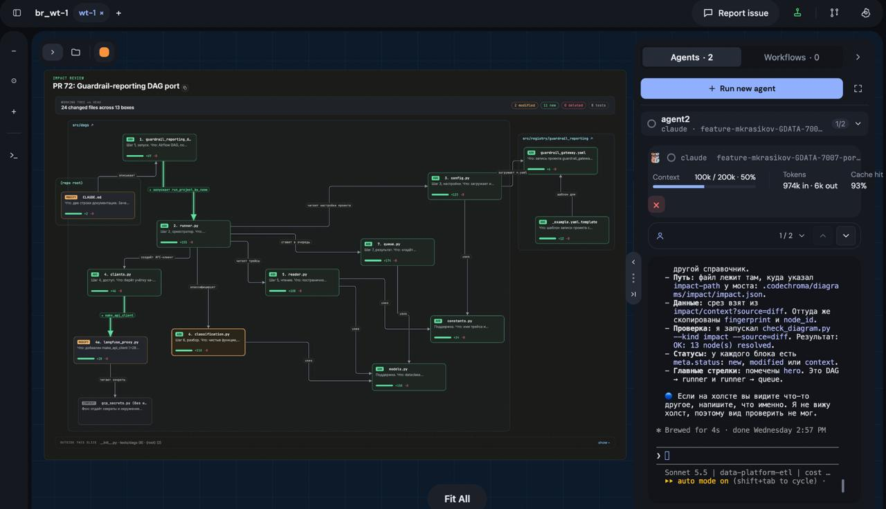

# CodeChroma

<p align="center">
  <a href="#install"></a>
  <a href="https://github.com/gutzerk/code_chroma/stargazers"></a>
</p>

**See your codebase's architecture, let AI agents change it, and understand every change on the map.**

## See it in action



*Explore your code at multiple levels at once.*



*Work with multiple AI agents side by side, right in the app.*



*Review code and changes on the architecture map.*

## how it works

1. **Open a repo** — a local folder or a GitHub URL. No API key needed.
2. **See its architecture** — CodeChroma builds a zoomable map (System → … → Code) from the real code structure, not the folder layout.
3. **Launch an AI agent** — start Claude Code sessions from the canvas, each in its own git worktree.
4. **Understand the changes** — the Change Impact view shows which boxes the agent touched, and the map updates live as files change.

## features

- **zoomable canvas** — the code hierarchy (System → … → Code) lives in a left Project tree, and every diagram (C1, patterns, epics, …) sits as a layer on the same canvas.
- **live sync** — edit a file and the map updates in place: new blocks appear, deleted ones fade out, no reload.
- **diagrams as layers** — C1, Design Patterns, Change Impact, Epics, Sequence, or a custom type — show, hide, or delete.
- **AI agents** — describe a diagram in plain language and a built-in agent draws it; run parallel Claude Code sessions, each in its own worktree.
- **PR workspaces** — paste a PR URL and browse its head as a read-only workspace.
- **desktop app** — a native (C# / Avalonia) double-click app and installer, no Python or Node needed.
- **works with or without a key** — analysis, canvas, and live sync run on a deterministic offline summarizer; set a key to unlock AI features.

## install

Desktop app — one command:

| Platform | Command |
|---|---|
| macOS (Apple Silicon or Intel) / Linux (x64) | `curl -fsSL https://raw.githubusercontent.com/gutzerk/code_chroma/main/distribution/install.sh \| sh` |
| Windows (x64) | `powershell -ExecutionPolicy Bypass -c "irm https://raw.githubusercontent.com/gutzerk/code_chroma/main/distribution/install.ps1 \| iex"` (or run `distribution/install.cmd`) |

All platforms install per-user (macOS and Linux into `~/Applications`) and do not request administrator
access. The installers check the SHA-256 from the release's `latest.json`, and also run
`gh attestation verify` when the GitHub CLI is installed and logged in (otherwise they warn that only
the checksum was checked).
Re-running the command installs a newer version and skips the same one (`--force` / `-Force` to
reinstall).

**Update:** the app checks for a new release at start-up, every 6 hours and when its window regains
focus; open **Updates** to download, skip a version or turn on automatic download. In-app updates are
verified by SHA-256 checksum only (not signed or attested) and roll back automatically if the new
version fails to start. **Uninstall:**
re-run the installer with `--uninstall` (`-Uninstall` on Windows); add `--purge` / `-Purge` to also
delete settings and caches.

**First launch:** release builds are not yet code-signed. On macOS a browser-downloaded app may need
right-click → Open (or `xattr -dr com.apple.quarantine ~/Applications/CodeChroma.app`); on Windows
SmartScreen may show "More info → Run anyway"; the Linux AppImage needs FUSE (`libfuse2`).

From source — point it at any repo:

```bash
poetry install
cd web && npm install && cd ..
poetry run python -m codechroma.bridge.launch --repo-path /path/to/your/repo
```

Or open a GitHub project without cloning it yourself — `--github` takes a URL or `owner/repo[@ref]`:

```bash
poetry run python -m codechroma.bridge.launch --github owner/repo
```

Open the URL it prints (usually `http://localhost:5173`) and start clicking. See [`QUICKSTART.md`](./QUICKSTART.md) for the full walkthrough, [`web/QUICKSTART.md`](./web/QUICKSTART.md) to explore the UI offline, and [`CLAUDE.md`](./CLAUDE.md) for the command reference and documentation map.

## docs

- [QUICKSTART.md](./QUICKSTART.md) — install → launch → explore
- [docs/architecture/](./docs/architecture/) — one focused doc per subsystem (engine, diagrams, canvas, PR workspaces, parallel agents, desktop app)

## development

```bash
poetry install
poetry run pytest           # Python tests
poetry run ruff check .     # lint
cd web && npm install
npm test                    # Vitest
npm run e2e                 # Playwright
```

## contributing

See [CONTRIBUTING.md](CONTRIBUTING.md) for setup, contributor rules, checks and the PR workflow.
File issues and feature ideas under `docs/planning/`. See [`CLAUDE.md`](./CLAUDE.md) for the architecture map and repo-wide conventions.

## license

CodeChroma is released under the [MIT License](LICENSE).
